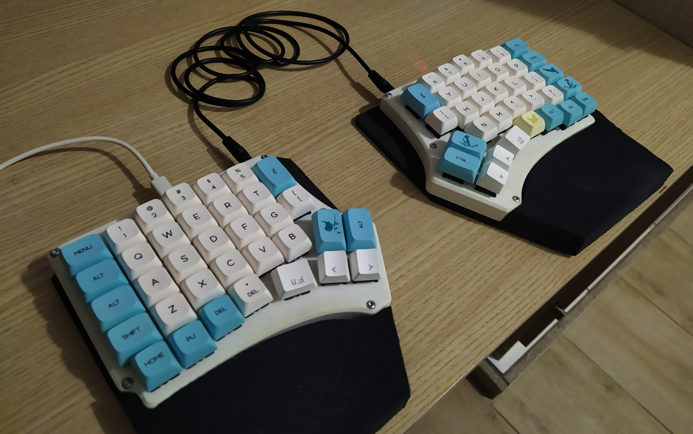
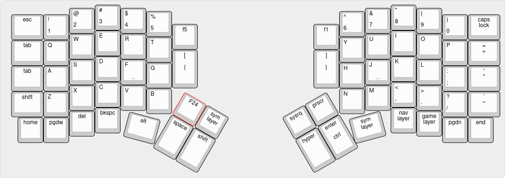
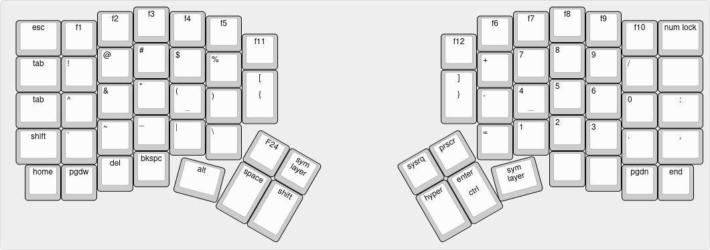
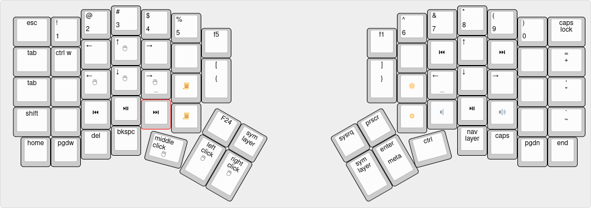
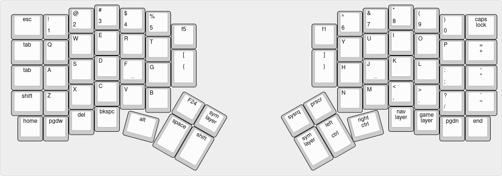

* My custom keyboards
** Redox
   My first custom keyboard is a [[https://github.com/mattdibi/redox-keyboard][Redox]], by Mattia Dal Ben. Thank you Matt, you saved my hands.
*** Keyboard
    This is what my keyboard looks like:
    
*** Keymap
    My current layers look like this:
    - Main:
      
    - Symbols:
      
    - Navigation:
      
    - Gaming:
      
*** Build log
    I have written a [[./keyboards/redox/rev1/build-log/readme.org][build log]] of my keyboard, in Portuguese. This might help you in
    building your own. If you don't speak Portuguese, you can always follow the [[https://github.com/mattdibi/redox-keyboard/tree/master/redox][original
    guide]].
*** Compile and flash firmware
    Just run:
    #+begin_src bash
      qmk compile --keyboard redox/rev1 --keymap default
      qmk flash --keyboard redox/rev1 --keymap default
    #+end_src
    and then press the reset button.
** Dactyl Manuform
   My second custom keyboard is a handwired Dactyl Manuform. With this new iteration, I'm
   hoping to solve some thumb pain issues I had with Redox.
*** Pinout
    | Wire | Arduino pin | AVR pin | __________ | AVR pin | Arduino pin | Wire |
    |  <r> | <l>         | <l>     |          |     <r> |         <r> | <l>  |
    |------+-------------+---------+----------+---------+-------------+------|
    |      | Raw         | Raw     |          |      D3 |         Tx0 |      |
    |      | Gnd         | Gnd     |          |      D2 |         Rx1 |      |
    |      | Rst         | Rst     |          |     Gnd |         Gnd |      |
    |      | Vcc         | Vcc     |          |     Gnd |         Gnd |      |
    |      | A3          | F4      |          |      D1 |           2 |      |
    |   C7 | A2          | F5      |          |      D0 |           3 | P3   |
    |   C6 | A1          | F6      |          |      D4 |           4 | L6   |
    |   C5 | A0          | F7      |          |      C6 |           5 | L5   |
    |   C4 | 15          | B1      |          |      D7 |           6 | L4   |
    |   C3 | 14          | B3      |          |      E6 |           7 | L3   |
    |   C2 | 16          | B2      |          |      B4 |           8 | L2   |
    |   C1 | 10          | B6      |          |      B5 |           9 | L1   |
*** Compile and flash firmware
    #+begin_src bash
      qmk compile --keyboard handwired/dactyl_manuform/5x7 --keymap default
      qmk flash --keyboard handwired/dactyl_manuform/5x7 --keymap default
    #+end_src
